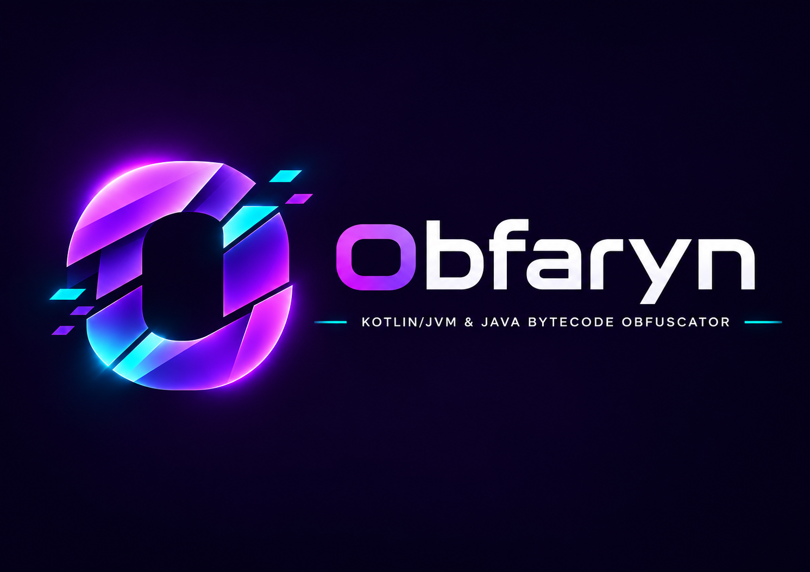

<p align="center"></p>

# Obfaryn

[English](README.md)

ASMベースのKotlin/JVM・Java JAR難読化ツールです: 文字列/数値リテラル暗号化、クラス・メソッド・フィールドのリネーム、任意の制御フロー・呼び出し間接化保護、VM風メソッド仮想化、オフライン整合性封印。リリースは[Maven Central](https://central.sonatype.com/namespace/com.peco2282.obfaryn)で公開しています。

## クイックスタート

### パターン1 — Gradle plugin、デフォルトのみ

`settings.gradle.kts`:
```kotlin
pluginManagement {
  repositories {
    gradlePluginPortal()
    mavenCentral()
  }
}
```

`build.gradle.kts`:
```kotlin
plugins {
  java
  id("com.peco2282.obfaryn") version "1.0.0" // 実際に公開されている最新バージョンに置き換えてください
}
```

`obfaryn { ... }`ブロックは不要です——`protection = "standard"`、`platform = "auto"`、文字列/数値暗号化、デバッグ情報除去、リネームはいずれも既定で有効です。実行:
```bash
./gradlew obfuscateJar
```
出力は`build/libs/<名前>-obfuscated.jar`、同じ場所に`.mapping.txt`も出力されます。全オプションは[Gradle プラグイン](#gradle-プラグイン)を参照してください。

### パターン2 — Gradle plugin、シード指定とstrong保護

```kotlin
obfaryn {
  seed = 123L                              // 実行ごとに再現可能な出力
  protection = "strong"                    // 制御フローと厳格な出力チェックを追加
  applicationPackages = listOf("com.example.myapp") // strong保護に必須
  keep = listOf("com.example.myapp.PublicApi")      // 公開エントリポイントの名前を保持
}
```

### パターン3 — CLI、デフォルトのみ

GitHub Releaseからインストール(Linux/macOS):
```bash
curl -fsSL https://raw.githubusercontent.com/peco2282/Obfaryn/main/scripts/install.sh | bash
```
Windows(PowerShell):
```powershell
iwr https://raw.githubusercontent.com/peco2282/Obfaryn/main/scripts/install.ps1 -UseBasicParsing | iex
```
またはチェックアウトしてビルド:
```bash
git clone https://github.com/peco2282/Obfaryn.git && cd Obfaryn
./gradlew :obfaryn-cli:installDist
./obfaryn-cli/build/install/obfaryn/bin/obfaryn input.jar
```
以降はどこからでも:
```bash
obfaryn input.jar
```
Gradle pluginと同じ`standard`デフォルトです。出力は入力と同じ場所の`input-obfuscated.jar`。全フラグは[CLI](#cli)を参照してください。

### パターン4 — CLI、よく使う数個のフラグ

```bash
obfaryn input.jar -o output.jar --seed 123 --protection strong \
  --application-package com.example.myapp --keep com.example.myapp.PublicApi
```

複数プロジェクトで使い回すフラグ組み合わせは名前付きプリセットとして保存できます——[名前付きプリセット](#名前付きプリセット)を参照。

### パターン5 — platform指定(例: Paper)

```kotlin
dependencies {
  obfarynPlatform("com.peco2282.obfaryn:obfaryn-platform-paper:1.0.0")
}
obfaryn {
  platform = "paper"
}
```
`obfarynPlatform`はplugin自身と同じリリースリポジトリから解決され、アプリケーション自身のクラスパスや出力JARには追加されません。CLIで同じことをするには、`obfaryn-platform-paper`のJARを自分でダウンロードし`--extension`で渡します: `obfaryn input.jar --extension obfaryn-platform-paper-1.0.0.jar --platform paper`。[拡張JARの読み込み](docs/assembly.ja.md#拡張jarとして配る)を参照してください。

---

APIだけに依存して独自パーツ・構成パッケージを定義できます。coreは標準Transformerへ依存しません。[組み立てと拡張契約](docs/assembly.ja.md)を参照してください。

小さなKotlinラムダにも文字列暗号化を適用できるよう、増加率予算には既定64命令の累積増加許容量があります。Gradle の `performance { growthAllowanceInstructions = 64 }`、CLI の `--growth-allowance-instructions 64` で調整でき、`0` は厳密な比率制限です。追加命令数と出力コード長の上限は引き続き適用します。計算式と優先順位は[保護設定の詳細](docs/protection.ja.md#構造的な変換予算)を参照してください。

機能別アノテーション、累積の構造予算、整数演算変換、範囲指定の事前解決、公開プロジェクト・性能の継続検証は [保護設定の詳細](docs/protection.ja.md) を参照してください。

予算対象パスの生成ヘルパークラスにもコード長の予算とメソッド別報告を適用します。出力先の衝突検査は、入力や他の成果物のハードリンク・シンボリックリンクによる別名も拒否します。

Gradle では `controlFlow { mode = "light" }`・`calls { enabled = true; prelink = true }`・
`arithmetic { enabled = true; maxOperationsPerMethod = 4 }`・`reports { methods = "build/methods.json" }`・
`rules { method("com/example/.*") { calls = false } }` で設定を整理できます。CLI では
`--control-flow-mode light`・`--disable-feature 'calls=com/example/.*'` を使えます。
[設定例と優先順位](docs/protection.ja.md#gradlecli-からの設定)も参照してください。

## 要件

ビルドには JDK 21 および Kotlin Gradle Plugin 2.4.21 を使用します。`obfaryn-api`、`obfaryn-annotations`、`obfaryn-core`、`obfaryn-standard`、`obfaryn-transformer`、および CLI モジュールは Kotlin 言語/API バージョン 2.1 と Java 8 バイトコードを使用します。任意の `obfaryn-runtime` は Java のみで Java 8 を対象とし、外部依存はありません。Gradle プラグインは Java 17 以降を必要とします。難読化対象の JAR に必要な Java バージョンは、入力ファイルと有効化された変換内容に依存します。

| モジュール | 用途 |
| --- | --- |
| `obfaryn-api` | プラットフォームおよびトランスフォーマーのインターフェース |
| `obfaryn-annotations` | ソースレベルの変換ポリシーアノテーション |
| `obfaryn-runtime` | 任意の Java 8 事前解決 API と依存なしの実行時テンプレート |
| `obfaryn-standard` | 標準構成・改名・VM・整合性保護・設定付き実行API |
| `obfaryn-core` | 標準処理に依存しない実行エンジン・構成・予算・検証 |
| `obfaryn-transformer` | 標準トランスフォーマー（文字列、数値、制御フロー、メタデータ） |
| `obfaryn-cli` | コマンドラインアプリケーション |
| `obfaryn-gradle-plugin` | Gradle 統合プラグイン |
| `platforms/paper` | 外部 Paper プラットフォームプロバイダー (`obfaryn-platform-paper`) |

## ライセンス

Obfaryn の独自ソースコード（API、アノテーション、core、transformer、CLI、Gradle プラグインを含む）は [Mozilla Public License 2.0](LICENSE) の下で提供されます。Obfaryn のソースファイルを改変して配布する場合は、そのファイルのソースを MPL 2.0 の条件で公開する必要があります。Obfaryn を単に利用する別ファイルには独自のライセンスを適用できます。Gradle Wrapper およびサードパーティ依存関係は、それぞれのライセンスを保持します。

## CLI

Windows の場合、アプリケーション配布物をビルドして実行します:

```powershell
.\gradlew.bat :obfaryn-cli:installDist
.\obfaryn-cli\build\install\obfaryn\bin\obfaryn.bat input.jar -o output.jar --platform paper --seed 123 --keep com.example.PublicApi
```

その他のプラットフォームでは `./gradlew` と生成された `bin/obfaryn` スクリプトを使用します。`--platform` は `auto`（既定値）、`generic`、および導入されたプラットフォームプロバイダーが提供する ID（`paper` など）を受け付けます。Paper の例では実行時クラスパスに `obfaryn-platform-paper` が必要です。

インストールされた配布物の `bin` ディレクトリを `PATH` に追加している場合:

```shell
obfaryn input.jar                         # 既定では入力と同じ場所に input-obfuscated.jar を出力
obfaryn --seed=42 input.jar --keep-debug-info
obfaryn obfuscate input.jar -o output.jar  # 明示的な obfuscate コマンドは省略可能
obfaryn @obfaryn.args
obfaryn --help
```

オプションは入力 JAR の前後に指定可能で、`--option=value` 形式もサポートしています。長い設定は引数ファイルで再利用できます。例 (`obfaryn.args`):

```text
input.jar
--output "build/protected jars/output.jar"
--seed 42
--keep 'com.example.api.**'
--keep-debug-info
```

空白や `#` を含む値はクォートで囲んでください。`--keep-debug-info` はソース/デバッグ情報を保持します。`--no-string-constant-fields` および `--no-number-constant-fields` はメソッド内のリテラル変換を無効化することなく、定数フィールドの展開処理のみを個別に無効化します。

### 名前付きプリセット

`obfaryn.args`は便利ですが、毎回フルパスを書く必要があり、名前で発見・共有する手段がありません。`--preset NAME`はその名前付き版です — `@<dir>/NAME.args`に展開され、優先度順に`--preset-dir DIR`(繰り返し指定可、最優先)、プロジェクトローカルの`.obfaryn/presets/`、ユーザー全体の`~/.obfaryn/presets/`から解決されます。ユーザー全体用ディレクトリは、個人が自分用のレシピを一度保存してどのプロジェクトからでも`--preset NAME`で再利用できる、パス入力不要のケースに対応します。`--preset`/`--preset-dir`は通常のオプションではありません——Picocliが解析する前に`@file`構文へ置き換えられるので、プリセットファイルは上記の`obfaryn.args`と全く同じ形式で、さらに`@file`/`--preset`を含めることもできます。

```shell
mkdir -p ~/.obfaryn/presets
cat > ~/.obfaryn/presets/strong-paper.args <<'EOF'
--platform paper
--protection strong
--control-flow-mode light
EOF
obfaryn input.jar --preset strong-paper -o output.jar
obfaryn list-presets   # 何も適用せずに利用可能なプリセットを確認
```

プリセット名に使えるのは英数字・`-`・`_`・`.`のみで、パス区切り文字は使えません。解決できない名前は他の引数解析より前にエラーになります。`list-presets`も同じ`--preset-dir`を受け付けますが——他のすべてのコマンドにおける`--preset`とは異なり——プリセットを解決するために消費するのではなく、スキャン対象を指定する通常のオプションとして解析します。

### シェルの補完

`scripts/install.sh`はbash補完スクリプトを自動でインストールします(`${XDG_DATA_HOME:-~/.local/share}/bash-completion/completions/obfaryn`。自動読み込みには`bash-completion`パッケージが必要です)。PowerShellには補完スクリプトがありません(picocliの`AutoComplete`はbash/zsh用のみ生成します)。自分で生成したい場合やZshの場合:

シェルで補完スクリプトを生成して読み込むことで、コマンド、オプション、選択肢、ファイルパスの補完が可能になります:

```bash
obfaryn completion bash > obfaryn-completion.bash
source ./obfaryn-completion.bash
```

Zsh の場合（生成スクリプトが `compinit` / `bashcompinit` を初期化します）:

```zsh
obfaryn completion zsh > obfaryn-completion.zsh
source ./obfaryn-completion.zsh
```

生成したファイルを保存し、以降のセッションのために `.bashrc` / `.zshrc` から読み込んでください。CLI アップグレード後は再生成してください。

| オプション | 効果 |
| --- | --- |
| `--mapping path` | マッピングファイルの出力パスを指定。既定では名前変更時に入力/出力 JAR の隣に `*.mapping.txt` を生成。 |
| `--report path` | 変換件数と警告を JSON 形式で出力。 |
| `--dry-run` | JAR やマッピングを書き込まずに、計画された件数とマッピングのみを確認。 |
| `--verify-output` | ASM の `CheckClassAdapter` を使用して出力クラスを検証。 |
| `--classpath dependency.jar` | 外部依存関係を追加（複数指定可能）。 |
| `--recompute-frames` | StackMap フレームを再計算。 |
| `--application-package package` | アプリケーションパッケージルートを追加（複数指定可能）。 |
| `--strip-generic-signatures`, `--keep-method-parameters` | シグネチャおよびメソッドパラメータのメタデータを制御。 |
| `--no-string-encryption`, `--no-number-obfuscation`, `--no-rename` | 各難読化パスを個別に無効化。 |
| `--stacktrace` | 失敗時に1行のエラーだけでなく、原因チェーン全体とスタックトレースを出力する。`--preset`と同様、解析前に消費される通常のオプションではない。 |

`--keep` は完全一致クラス名、単一パッケージ用の `com.example.*`、再帰パッケージ用の `com.example.api.**`、メソッド用の `com.example.Class#method()V`、フィールド用の `com.example.Class#field` を受け付けます。メソッドシグネチャには JVM 記述子（descriptor）を使用します。`@KeepName` は宣言の名前のみを保持します。

保存されたマッピングを使用してスタックトレースを復元する場合:

```shell
obfaryn deobfuscate-stacktrace --mapping output.mapping.txt stacktrace.txt
```

クラス名および一意に識別可能なメソッド名を復元できます。削除された行番号は復元できません。

### 互換性ルール

Kotlin メタデータモードの既定値は `AUTO` です。`AUTO` と `PRESERVE`（`--preserve-kotlin-metadata`）はどちらもアプリケーションのメタデータを保持し、名前変更や再配置に合わせてクラス名、型、JVM シグネチャ、Kotlin モジュールマップを安全に書き換えます。対象となる Kotlin 関数・プロパティと JVM メンバーシグネチャも連携して名前を変更します。keep ルールと外部 API のオーバーライドは引き続き保護します。マルチファイルファサード、値クラスの ABI ヘルパー、`@JvmStatic`、データクラスの component 関数、callable reference など、コンパイラが名前で参照するメンバーは保守的に保護します。対応するデフォルト引数付きメソッドと `$default` ヘルパーは連動してリネームし、Kotlin の既定引数呼び出しとリフレクションを維持します。保持は宣言クラスとシグネチャに限定し、無関係な同名メソッドには波及しません。enum 定数名も保持します。選択されたプラットフォームプロバイダーが報告するエントリポイント、またはマニフェストのエントリポイントによってアプリケーションパッケージルートが確定し、既知のルート外にある同梱クラスの名前は保持されます。`--application-package` でルートを追加できます。明示的な `STRIP`（`--strip-kotlin-metadata`）のみが、除外指定やアノテーションポリシーに従って JAR 全体でのメタデータ削除を要求します。削除は Kotlin リフレクションや `kotlinx.serialization` を破損させる可能性があるため、対象ランタイムでテストしてください。

メタデータの対応範囲は `kotlin-metadata-jvm` 2.4.21 の `readStrict` に従い、読み取り可能な 1.1 形式以降を扱います。1.4 未満の形式は書き出し時に 1.4 へ更新されます。未知の形式や不透明なプラグインペイロードは、安全でない書き換えをせず、出力前に明示的に拒否します。これはメタデータ形式の互換性を示すもので、すべての Kotlin コンパイラバージョンを検証済みという意味ではありません。

仮想メソッドは JAR 内のオーバーライドファミリー単位でまとめて名前変更されます。外部 API（`Runnable.run` など）をオーバーライドするファミリーや、未解決の外部スーパークラスに依存するファミリーは保持されます。`--classpath` で依存関係を指定することで、階層およびアクセス解析の精度が向上します。フレーム再計算時に未解決の外部型が必要になった場合、Obfaryn は推測せずに失敗します。それ以外の場合は既存のフレームが保持されます。

Record のクラス名は、Kotlin の入れ子 Record を含めて変更・再配置できます。Record を理由に外側のクラス名を保持することもありません。構成要素名・フィールド・アクセサなどの Record メンバーはまとめて保持し、リフレクション、正規コンストラクタ、自動生成メソッドとの整合性を維持します。明示的な keep、シリアライズ時の識別名、native メソッドによる制約は引き続き適用します。

Kotlin の value class はクラス名に加えて、通常の関数・プロパティ・バッキングフィールドも変更できます。boxing・unboxing・構築・等価比較などに必要な ABI ヘルパー名は保持します。Kotlin の呼び出し側が再配置後の型名から互換性のないメソッド名を再計算しないよう、`@JvmName` とメタデータを連動させます。既存の `@JvmName` の値と基底プロパティのメタデータも更新します。別の Kotlin コードから利用する場合はメタデータの保持が必要です。

enum クラス名は通常の keep ルールに従いますが、列挙定数名は `name()` や `valueOf()` のために保持されます。アノテーション型名は変更される可能性がありますが、アノテーション要素名は保持されます。外部コードや設定ファイルから参照される宣言は keep 指定してください。

アプリケーションパッケージ内の対象となる `static final` および Kotlin の `const val` 文字列・数値フィールドは、リテラル変換パスで処理できるように `ConstantValue` 属性からクラス初期化処理へ移動されます。明示的に keep されたフィールドは除外されます。これらのフィールドは Java のコンパイル時定数ではなくなるため、外部 API として公開する定数は keep してください。 `Object` 以外を継承するクラス、または実装・継承インターフェースを持つクラスでは、上位型の初期化中に `<clinit>` より先に再入する可能性があるため `ConstantValue` を保持します。定数フィールドのレポートでは `initializationSkippedClasses` に集計し、メソッド内のリテラル変換は継続します。文字列の復号もキャッシュ初期化前の再入に対応します。差分テストの検証範囲は[動作の回帰検証](docs/semantic-validation.ja.md)を参照してください。

## Gradle プラグイン

プラグイン ID は `com.peco2282.obfaryn` で、[Maven Central](https://central.sonatype.com/namespace/com.peco2282.obfaryn) に公開しています。利用側プロジェクトの `settings.gradle.kts`の`pluginManagement.repositories`に`gradlePluginPortal()`・`mavenCentral()`を追加してください:

```kotlin
pluginManagement {
  repositories {
    gradlePluginPortal()
    mavenCentral()
  }
}
```

Obfaryn自身の未リリースのローカルチェックアウトを対象にする場合は、上記の代わりにコンポジットビルドを使います:

```kotlin
pluginManagement { includeBuild("../Obfaryn") }
```

利用側プロジェクトの `build.gradle.kts` で設定します(デフォルトのみ・`obfaryn{}`ブロック不要なケースは[クイックスタート](#クイックスタート)参照):

プロバイダーと推移的な実行時依存は `obfarynPlatform` から難読化時に読み込まれ、アプリケーションのクラスパスや出力 JAR には追加されません。Obfaryn プラグインとバージョンを揃えてください。Groovy DSL: `obfarynPlatform "com.peco2282.obfaryn:obfaryn-platform-paper:VERSION"`。

```kotlin
plugins {
  java
  id("com.peco2282.obfaryn") version "1.0.0" // 実際に公開されている最新バージョンに置き換えてください
}

repositories {
  mavenCentral()
}

dependencies {
  obfarynPlatform("com.peco2282.obfaryn:obfaryn-platform-paper:1.0.0")
  compileOnly("com.peco2282.obfaryn:obfaryn-annotations:1.0.0")
}

obfaryn {
  platform = "paper"
  seed = 123L
  verifyOutput = true
  recomputeFrames = true
  string {
    enabled = true
    includeConstantFields = true
    // strategy = RollingStringEncryptionCodec() // 暗号化と復号コード生成を対で指定
  }
  number { enabled = true; includeConstantFields = true }
  metadata {
    stripDebugInfo = true
    kotlinMetadataMode = "auto" // auto, preserve, strip
    stripGenericSignatures = false
    stripMethodParameters = true
  }
  output {
    directory = "build/obfaryn"
    fileName = "app-obfuscated.jar"
    mapping = "build/mappings/app.txt"
  }
  applicationPackages = listOf("com.example.app")
  keep = listOf("com.example.api.*")
  rename {
    classes = true
    methods = true
    fields = true
  }
}
```

`obfuscateJar` は `shadowJar` が存在すればそれを、なければ `jar` を入力として使用します。出力設定を省略した場合は `build/libs/*-obfuscated.jar` とマッピングを生成します。プラグインはメソッドの名前変更、フレームの再計算、およびアノテーションで選択された仮想化のために、`runtimeClasspath` と `compileClasspath` を自動で供給します。

ネストされた `string` / `number` の `enabled` フラグおよび `metadata` のプロパティは、既存のフラットプロパティ（`stringEncryption`、`numberObfuscation`、`stripDebugInfo` など）と値を共有し、後に代入された設定が優先されます。Groovy DSL でも同じブロックが機能します。`includeConstantFields = false` はその定数種別に対する展開処理のみを無効化します。両方のリテラルブロックは任意の `random` ジェネレーターを受け付けます。省略した場合は既存の `seed` に従います。個別にカスタマイズする場合は `import java.util.Random` を追加し、`random = Random(10)` を設定します。`string.strategy` は暗号化と復号コード生成を対にする `StringEncryptionCodec` を受け付けます。数値には `number.strategy` と `number.selector` を指定できます。

`output.directory` / `fileName` で出力先フォルダーと名前をカスタマイズできます。明示的な `output.file = "dist/protected.jar"` は両方の設定に優先します。`mapping` を省略した場合は出力 JAR の隣に配置されます。パスはプロジェクト相対または絶対パスです。既定のディレクトリは Gradle の `buildDirectory` に従い、既存の `outputSuffix` も既定名に適用されます。入力 JAR、出力 JAR、およびマッピングのパスはすべて異なる必要があります。カスタム戦略や乱数ジェネレーターの状態を確実にフィンガープリントできないため、`obfuscateJar` は実行ごとに毎回実行されます。

## Core および Platform API

`Obfuscator(ObfuscationConfig(...)).obfuscate(input, output)` がコアのエントリポイントです:

```kotlin
val config = ObfuscationConfig(
  platform = "paper",
  platformConfiguration = {
    keepClass("com.example.PublicApi")
    keepMethod("com.example.Plugin", "publicEntry", "()V")
    keepResource("config.yml")
  },
)
Obfuscator(config).obfuscate(input, output)
```

Platform SPI はフレームワーク非依存です。Paper、Velocity、プライベートランタイム、プロジェクト固有の規約などはすべて同じ `Platform` インターフェースを実装します。`PlatformProvider` はメタデータを提供し、実行ごとに新しいプラットフォームインスタンスを生成します。`META-INF/services/com.peco2282.obfaryn.api.PlatformProvider` に登録してください。`detect` は信頼度スコアと理由を返し、`configure` は keep、リソース、リフレクション、および仮想化性能ポリシーを提供します。`entrypoints` は外部から呼び出されるライフサイクルクラスを報告します。ID は一意かつ空でない文字列である必要があり、`auto` は予約済みです。また、プロバイダーの API バージョンは `PlatformApi.VERSION` と一致している必要があります。

Paper サポートは core の外部の `platforms/paper` に配置されており、`com.peco2282.obfaryn:obfaryn-platform-paper` として公開されます。このプロバイダーが存在しない場合、core は `plugin.yml` を通常のリソースとして扱います。

プラットフォームの検出場所は意図的に SPI の一部として定義されていません。将来のローダーは CLI から任意の数の JAR ファイルやディレクトリを受け取る可能性があるため、実装は `platforms` という名前のディレクトリを前提にしてはなりません。プラットフォーム固有のフロントエンド設定には `PlatformOptions` を使用し、CLI からは繰り返し可能な `--platform-option key=value` 引数で、Gradle からは `platformOptions` で指定します。

```kotlin
class CustomPlatformProvider : PlatformProvider {
  override val metadata: PlatformMetadata = DefaultPlatformMetadata(
    id = "custom",
    displayName = "Custom Runtime",
    implementationVersion = "1.0.0",
  )

  override fun create(): Platform = CustomPlatform(metadata)
}

class CustomPlatform(
  override val metadata: PlatformMetadata,
) : Platform {
  override fun detect(context: PlatformContext): PlatformDetection =
    if ("custom-runtime.json" in context.resources)
      DefaultPlatformDetection(100, listOf("custom-runtime.json found"))
    else DefaultPlatformDetection(0)

  override fun entrypoints(context: PlatformContext, options: PlatformOptions): Set<String> =
    setOf("example/Bootstrap")

  override fun configure(
    context: PlatformContext,
    options: PlatformOptions,
    target: PlatformConfiguration,
  ) {
    target.keepResource("custom-runtime.json")
    target.keepClassNameOnly("example/Bootstrap")
    target.excludeMethodFromVirtualization("example/Bootstrap", "tick", "()V", "custom hot loop")
  }
}
```

プラットフォームは `Platform.extensions()` から制限付き拡張を返すことができます。`AnnotationPolicyProvider` はサードパーティのバイナリアノテーションを `obfaryn-annotations` に追加することなく、`NO_OBFUSCATION`、`RENAME_ONLY`、`KEEP_NAME`、`VIRTUALIZE`、または `HOT_PATH` にマッピングします。`ResourceContributor` は非クラス JAR エントリを追加し、`ClassContributor` はコンパイル済みの完全なクラスファイルを追加します。追加されたクラスは通常の Obfaryn パイプラインに入り、名前変更、パッケージ平坦化、本体変換、フレーム計算、および検証に参加します。

`ArchiveContributor` は `MERGE` と `EMBED_AS_RESOURCE` をサポートします。Merge は重複エントリ、署名付きアーカイブ、`module-info.class`、マルチリリースエントリを拒否し、マニフェストはコピーされません。埋め込みアーカイブは明示的なリソースパスを必要とし、データとして扱われます。`PlatformPackages`から独自の構成パッケージとASM変換を共通レジストリへ登録できます。ソースのコンパイルは拡張実装の責務です。

## Transformer 拡張 API

初めて拡張を書く方向けの実装・実行例は [API 開発ガイド](obfaryn-api/README.ja.md) を参照してください。依存関係、コンテキスト、プラットフォームの登録、リテラル変換、検証手順を説明しています。

外部拡張は `obfaryn-api` の `Transformer` と `PipelineConfigurer` を実装し、ランチャーがこれらを core に渡します。文字列暗号化、数値難読化、制御フロー変換、定数フィールド変換、およびメタデータ削除は `obfaryn-transformer` に分離されています。このモジュールは API と小さな実行時テンプレートのモジュールに依存し、core やプラットフォームには依存しません（バイトコード解析に ASM も使用します）。既存のパッケージ名は維持され、`obfaryn-standard`が標準パーツを推移的に公開します。coreはtransformerへ依存しません。

名前変更・仮想化・整合性保護・標準構成は`obfaryn-standard`に配置しました。coreはAPIで定義した利用者のパッケージを独立して実行できます。[組み立て契約](docs/assembly.ja.md)を参照してください。

```kotlin
import com.peco2282.obfaryn.api.transformer.PipelineConfigurer

val extension = PipelineConfigurer {
  // 実行間での状態共有を避けるため、ステートフルなパスはここで生成します。
  val customTransformer = CustomStringTransformer() // id = "string-encryption"
  if (this[customTransformer.id] != null) {
    replace(customTransformer.id, customTransformer)
  } else {
    this += customTransformer
  }
}

Obfuscator(config = config, pipelineConfigurers = listOf(extension))
  .obfuscate(input, output)
```

`registry["id"]` は登録済みのパスまたは `null` を返します。`add` / `+=` は重複 ID を拒否し、`disable` は未知の ID を拒否し、`replace` は既存の ID と一致する置換 ID を要求します。無効化された標準パスは登録されません。コンフィグラーはレガシーな `configurePipeline` コールバックの後にリスト順で実行され、その後に依存関係の欠落や循環が検証されます。依存関係は数値順よりも優先され、実行可能なパスは `order`、次いで ID の順に選択されます。同一 ID に対する複数回の置換は後勝ちです。

このように構築した `PipelineConfigurer` は、`Obfuscator(...)` を直接呼び出すランチャー内か、Gradleビルドスクリプトの `pipeline { }` ブロック内に埋め込んだ場合にのみ動作します。自前のランチャーを持たずJARとしてモジュールを配布するなら、代わりに同じレジストリ専用の編集を`TransformationPackageProvider`/`--package`/`packageIds`で公開してください——ServiceLoaderで発見可能、`id`で明示選択、providerのJARを導入しただけでは暗黙に実行されません。recipeがレジストリしか必要としない場合は、`TransformationPackage.configure`が受け取る`context`引数を単に無視するだけで済みます。[サンプルprovider](examples/custom-extension/src/main/kotlin/example/extension/ExamplePackage.kt)を参照してください。何も変換せずに、あるクラスパスで実際にどのplatform・packageのprovider IDが見えているかを確認するには、`obfaryn list-extensions [--extension JAR]`またはGradleの`listObfarynExtensions`タスクを実行してください。

カスタム本体変換は、標準の本体変換やメソッドメタデータ削除と同様に、`context.transformationPolicy.canTransformBody(owner, method)` を参照する必要があります。クラス/フィールドのメタデータ削除は `canTransformMetadata(owner)` を参照し、定数変換は `canTransformConstant(owner, field)` を参照します。追加された 2 つのメソッドは既定で変更を許可し、SAM 構築を維持します。カスタムコンテキストでは既定ですべての変換が許可されます。ポリシーは推奨事項の確認用であり、ASM による変更を強制的に防ぐガードではありません。`@HotPath` を含む既存のアノテーションセマンティクスは変更されていません。

### 独自の数値変換方式

`obfaryn-api` のインターフェース `NumberObfuscationStrategy` を実装します。`generateInt(value, random)` と `generateLong(value, random)` は式の生成だけを担当します。`generateFloat` / `generateDouble` の既定実装は整数式とrawビット変換を使い、符号付きゼロとNaNペイロードを保持します。浮動小数点専用の式が必要な場合だけオーバーライドしてください。除外する場合は `null`、変換する場合は元のJVM型の値を積む新しい空でない `InsnList` を返します。既存のスタック・ローカル変数を維持し、分岐には有効なフレームを用意してください。実行時依存は自動同梱されません。

対象判定は別の `NumberObfuscationSelector.shouldTransform(site, random)` が担当します。コンテキスト・クラス・メソッド・命令・値を参照し、自作アノテーションや乱数で選択できます。渡されたASMノードは変更しない契約です。Transformerは本体変換ポリシー確認、対象判定、型の振り分け、命令置換を担当します。`DefaultNumberObfuscationSelector` は整数・長整数の -1〜1 を除外し、`DefaultNumberObfuscationStrategy` は従来の3種類の式だけを生成します。小さい整数も対象にする場合は `selector = NumberObfuscationSelector { _, _ -> true }` を指定します。

```kotlin
val passes = transformers {
  number {
    strategy = MyNumberStrategy()
    selector = NumberObfuscationSelector { site, random ->
      site.method.name != "hotLoop" && random.nextInt(100) < 70
    }
  }
  string { codec = MyStringCodec() }
}
```

`NumberObfuscationSelector` は `com.peco2282.obfaryn.api.transformer` からインポートします。コア設定には `numberStrategy` / `numberSelector`、Gradleには `number { strategy = ...; selector = ... }` を用意しています。フィールド定数は先行パスで命令へ変換されるため、フィールド単位の除外には定数変換ポリシーを使用してください。

### 独自の文字列暗号化方式

`obfaryn-api` の `StringEncryptionCodec` は、`encrypt(value, key): StringEncryptionResult` と `generateDecryptor(owner, method)` を対で実装する拡張口です。方式の実装自体は API モジュールだけに依存できます。標準パスのビルダーでは `string { codec = MyCodec() }`、直接置換する場合は `StringEncryptionTransformer(java.util.Random(10), MyCodec())` を `PipelineConfigurer` から登録してください。

復号結果はクラスごとの固定スロットに遅延キャッシュし、intern によって JVM の文字列リテラルの参照同一性を維持します。再取得時は atomic なキャッシュ参照だけを行い、初回の並行呼び出しでは複数回復号される場合があります。大きな暗号文は定数プールに収まる単位に分割し、キャッシュ未取得時だけ組み立てます。スロット数に応じたメモリを使用し、一度使用した平文はメモリに保持されます。カスタム復号処理は決定的かつ並行実行可能である必要があります。復号メソッドはクラスごとに必要な場合のみ生成され、引数は暗号化結果の `payload: String` と `key: Int`、戻り値は元の文字列です。渡された `MethodNode` の名前・記述子・アクセスフラグを維持し、命令・ローカル変数数・スタック上限と、分岐に必要なスタックマップフレームを生成してください（ホストでフレーム再計算を有効にする場合を除く）。復号コードから参照する外部ライブラリは出力先の実行環境にも必要で、方式の実装クラスが自動で同梱されるわけではありません。

`codec` の既定値は `RollingStringEncryptionCodec()` です。鍵付きの状態更新と暗号文フィードバックで UTF-16 コード単位を加工し、孤立サロゲートや NUL も維持します。暗号学的な秘匿性を保証する方式ではなく、復号コードと鍵は出力に含まれます。`XorStringEncryptionCodec()` は互換用に引き続き利用できます。標準方式も独自方式も同じインターフェース・実行経路を使い、暗号化専用の `StringEncryptionStrategy` は削除しました。コアの `stringEncryptionStrategy` とGradleの `string.strategy` も `StringEncryptionCodec` を受け取ります。`encrypt` は難読化時の加工、`generateDecryptor` は出力プログラムで動く復元コードの生成です。アノテーションによる本体変換ポリシーは独自方式でも優先されます。

### 標準パスのビルダー

`obfaryn-transformer` は `TransformersBuilder` と、公開の `StringBuilder` / `NumberBuilder` / `MetadataBuilder` インターフェース（および内部実装）を提供します:

```kotlin
import com.peco2282.obfaryn.transformer.builder.transformers

val passes = transformers {
  string {
    codec = com.peco2282.obfaryn.transformer.RollingStringEncryptionCodec()
    includeConstantFields = true
    random = java.util.Random(10)
  }
  number { includeConstantFields = false }
  metadata { stripDebugInfo = true }
}
```

`string()` および `number()` は登録時にオプションをスナップショットします。`includeConstantFields` の既定値は `true` です。`build()` は要求された値の型に対して最大 1 つの共有定数フィールドプリプロセッサを追加します。要求されていない型に対するパスは追加されません。文字列/数値の重複登録や、手動で追加された定数プリプロセッサとの競合は拒否されます。旧 `constants {}` / `ConstantsBuilder` / `ObfTransformers.constants*` エントリポイントはこれらのオプションに置き換えられました。戦略や乱数の引数は `string {}` または `number {}` 内に移動してください。ビルダーとパスは実行ごとに新しく作成してください。`build()` を繰り返し呼び出すとリストはスナップショットされますが、登録済みパスインスタンスは再利用されます。乱数の既定値はホストのシードと連動しないため、再現性が必要な場合はシード付きの `java.util.Random` インスタンスを渡してください。core は引き続き依存関係の検証とパスの順序付けを行います。標準パスを置き換えるには、`PipelineConfigurer` と `replace`（存在しない場合は `add`）を使用し、必要に応じてプリプロセッサも含めてください。

`context.transformationInputs` はアプリケーションスコープ、定数保持判定、およびクラスごとの Kotlin メタデータ削除判定を提供します。core はカスタムパスやフィルタリングされたコンテキストを含め、現在の実行からこれらを設定します。未知のスコープはすべてのクラスではなく、対象クラスなし（アプリケーションクラスなし）として扱われます。ルート、keep 述語、メタデータクラスセットを受け取る従来のコンストラクタ引数は引き続き利用可能ですが、新しいビルダーではユーザーオプションのみを指定します。明示的なルートはコンテキストのスコープを上書きし、keep 判定は合算され、メタデータ削除要求は加算的に適用されます。既存のアノテーションポリシーのチェックは変更されていません。標準構成は`obfaryn-standard`の`StandardPackage`が担当し、coreからtransformerへの依存はありません。

VM選択は明示指定主体です。`context.namePreservation`からAPIのみの独自renamerも保持ルールを参照でき、`RenamingTransformer`が公開するマッピングを元識別子の追跡と出力に使います。置換するrenamerは、除外クラスを含む影響する全参照を更新する責任を持ちます。Paper 固有のコールバック検出は引き続き `platforms/paper` に配置されます。

## 正規表現除外と制御フロー

CLI は繰り返し可能な `--exclude-class regex`、`--exclude-resource regex`、`--exclude-renaming regex`、および `--exclude-virtualization regex` を受け付けます。正規表現は元の JVM 内部クラス名（`com/example/Type`）、リソースパス、または `owner.method(descriptor)` に対する**完全一致**です。不正なパターンは変換処理の開始前に失敗します。

`excludeClasses` は本体変換と名前変更を抑止しますが、名前変更された宣言への参照は引き続き更新されます。`excludeRenaming` は名前変更のみを抑止します。`excludeResources` はリソース変換を抑止しますが、不要になった古い JAR 署名は削除されます。そのため、除外されたエントリであってもバイト単位で同一であることは保証されません。

`--target-package hidden --flatten-packages` は、メタデータを安全に書き換えられる Kotlin クラスを含め、名前変更の対象となったクラスを共通パッケージへ集約します。Kotlin の入れ子クラスと inner クラスも外側のクラスとの関係を維持して短い名前に変更します。companion object 名は Kotlin リフレクションのため保持します。両方の設定を同時に指定する必要があり、keep ルールも引き続き適用されます。Obfaryn は保護された構造、パッケージプライベートアクセス、未解決の同一パッケージ内参照、または相対リソース取得を持つパッケージを保守的に保護し、警告を出力します。設定ファイル内に埋め込まれた任意のクラス名を書き換えるものではありません。

`--control-flow` は適用可能なメソッドをキー付き switch ディスパッチへ変換します。遷移先は現在の状態から辺ごとの XOR または加算で求め、変換したブロック内の数値もその状態を使って復元します。数値の復元と制御フロー解析を関連付けますが、記号実行による復元を防ぐものではありません。適用できないメソッドは設定された数値変換方式を維持します。追加の整数演算により実行負荷が増える場合があります。コンストラクタ、クラス初期化子、および大きなメソッドは対象外です。制御フローおよび仮想化を適用するとフレームの再計算が自動でトリガーされるため、クラスパスに外部依存関係が必要になる場合があります。

既存の `tableswitch`・`lookupswitch` 分岐（Kotlin の `when` など）も平坦化に組み込めます。スタックに値が残る境界やローカルスロットの型再利用で平坦化できないメソッドには、基本ブロックを再配置し、直接の JVM 分岐で接続する軽量変換を適用します。この代替変換はインタープリタ、ボックス化、ヘルパー呼び出し、状態ディスパッチを追加しません。例外処理の保護範囲はブロック境界で分割して維持します。コンストラクタと大きすぎるメソッドは引き続き除外し、アノテーションとクラス除外設定も維持します。

速度を重視する通常コードには `--lightweight-control-flow`（Gradle/core: `lightweightControlFlow = true`）を指定してください。強化保護でも状態ディスパッチより優先し、条件式やスタック上の値の受け渡しを変えずに、直接分岐によるブロック再配置だけを行います。ただし追加ジャンプや配置変更は JIT・実行速度に影響し得るため、難読前と同等速度や���コンパイル失敗は保証しません。最新のデコンパイラでは構造を復元される場合があります。実負荷で測定してください。この設定は別途選択した VM 化・文字列暗号化・数値難読化を無効化しません。`@HotPath` によるメソッド本体変換の除外は維持します。

## VM を使わない呼び出しの間接化

CLI の `--call-indirection`、Gradle/core の `callIndirection = true` で、対象の static・virtual・interface 呼び出しを `invokedynamic` に変換できます。呼び出し先のクラス名・メソッド名・ディスクリプタは、名前変更後に呼び出し箇所ごとの鍵で符号化します。生成した Java 8 対応ヘルパーが元の呼び出し元の lookup で解決し、`ConstantCallSite` に固定します。復号と検索はリンク時に実施し、通常の呼び出しごとには行いません。JVM による最適化が可能ですが、初回リンクと実行時のコストがなくなる保証はありません。鍵と解決済みハンドルは解析可能であり、暗号学的な保護境界ではありません。

この機能は `applicationPackages` または起点から得られるアプリケーション範囲を必須とし、fat JAR の依存ライブラリ本体には適用しません。コンストラクタ・クラス初期化子・synthetic メソッド・special 呼び出し・配列所有者・シグネチャ多態呼び出し・一部の呼び出し元依存 API は除外します。既存のラムダや文字列連結の bootstrap は維持します。`@HotPath`、`@NoObfuscation`、`@RenameOnly` とクラス除外を尊重します。生成物は JDK のみで動作し、別配布の Obfaryn ランタイムは不要です。カスタムパイプラインでは、名前変更と再配置をすべて終えた後に適用してください。文字列・メソッドサイズ・定数プールが class ファイルの上限を超える場合は、一部を直接呼び出しのまま残します。

Paper の fat JAR では、次のように VM を使わず設定できます。

```kotlin
obfaryn {
  platform = "paper"
  applicationPackages += "com.example.plugin"
  protection = "strong"
  lightweightControlFlow = true
  callIndirection = true
  flattenPackages = true
  targetPackage = "com.example.plugin"
}
```

`@Virtualize` や明示的な選択がなければ、この設定による VM 化はありません。高頻度な処理には `@HotPath` を指定してください。実行コストを増やして制御フローを強めたい場合は `lightweightControlFlow = false` にすると、strong によって対応可能なメソッドへ状態ディスパッチを適用します。`transformers { ... }` はリストを作る関数であり、`obfaryn { ... }` 内に置くだけでは Gradle のパイプラインに登録されません。有効な変換の差し替えには `pipeline { replace("control-flow", ControlFlowTransformer(Random(42))) }` を使い、新しい ID の変換には `add` を使ってください。CLI・JSON レポート・Gradle ログで `indirectedCalls`、`rearrangedMethods`、`dispatchedMethods` などの変換量を確認できます。

ブロック再配置は `try/catch/finally` を含むメソッドにも対応します。保護範囲をブロック境界で分割し、例外ハンドラの優先順位を維持します。コンストラクタと大きすぎるメソッドは引き続き除外します。

既存の `@Virtualize` も無効にして比較する場合は、CLI で `--exclude-virtualization ".*"` を指定します。Gradle ではビルドスクリプトの先頭に `@file:OptIn(com.peco2282.obfaryn.gradle.VirtualizeOptIn::class)` を置き、`virtualize { excludeMethods = listOf(".*") }` を指定します。この除外を外せば、アノテーションに基づく VM 化に戻ります。

Paper は `tick` / `onTick` のような任意の名前から高頻度処理を推測しません。イベントのアノテーションや実際のスケジューラ・ライフサイクルの契約に基づく VM 化除外のみを提供します。アプリ固有の性能方針はアノテーションか設定で指定し、core の変換は Paper 固有の名前判定を持ちません。

## 強化保護

Gradle ではアプリケーション範囲の強化保護を次の設定で有効にできます。

```kotlin
obfaryn {
  protection = "strong"
  applicationPackages += "com.example.plugin"
  platform = "paper" // ビルドツールのクラスパスに Paper provider が必要
}
```

CLI では `obfaryn input.jar --protection strong --application-package com.example.plugin --classpath dependency.jar`、core API では `protectionLevel = ProtectionLevel.STRONG` を使用します。既定値は従来の `standard` です。

strong は制御フロー変換、ASM 出力検証、フレーム再計算を有効にします。VM 化の対象は自動で増やしません。`@Virtualize` で明示的に選択します。既存のメソッドパターン指定も引き続き利用できます。アプリケーションルートの明示指定、またはプラットフォーム・マニフェストの起点からの検出が必要です。ルート外の同梱クラスは本体変換と名前変更から除外し、変更されたアプリケーション型への参照は更新します。リテラル変換と Kotlin Metadata の設定は引き続き指定できます。パッケージの flatten は独立した設定です。

strong は出力 JAR の隣に `<出力名>.virtualization.json` を生成します。`virtualizationReport` による出力先指定も可能です。明示指定には設定した選択モードを適用し、`strict` では未対応なら失敗します。VM 化されるメソッドがゼロでも成功します。`@HotPath` とユーザー指定の除外も利用できます。

Paper の性能除外はメソッドパターンによる選択に適用します。明示的な `@Virtualize` は Paper の性能除外を上書きします。パターン選択で性能除外を解除する場合は、Gradle で `platformOptions["virtualization-protect-hot-paths"] = "false"`、CLI で `--platform-option virtualization-protect-hot-paths=false` を指定できます。Paper による起動・イベント・スケジューラ・その呼び出し先の自動除外を解除し、起点名とプラグイン記述ファイルの保護は維持します。ユーザー指定の除外とソースの `@HotPath` は引き続き適用されます。tick の実行コストが増える可能性があるため、配備前に実際の負荷で計測してください。

コンストラクタ、モニタなどの未対応部分は読み取れる状態で残る場合があります。重要メソッドごとにレポートを確認してください。VM 化には実行時間とメモリのコストがあるため、実際のサーバー負荷で検証してください。JVM の検証成功やデコンパイル失敗だけでは、動作の同一性や解析への耐性を証明できません。元名を含むマッピング・解析レポートを公開 JAR と一緒に配布しないでください。

JDK 21 用の検証補助ツールも用意しています。

- `java -Xverify:all scripts/VerifyClasses.java output.jar dependencies.txt com.example.plugin` はクラスを初期化せず読み込み、宣言メンバーを検証します。`dependencies.txt` には依存 JAR・ディレクトリを1行1件で記載します。再配置した場合は移動先パッケージを指定してください。プラグインの起動・ゲーム動作を実行するものではありません。
- `java -cp "obfaryn-cli/build/install/obfaryn/lib/*" scripts/RemapTestClasses.java output.mapping.txt original-test-classes remapped-test-classes` はコンパイル済みテストの参照名をマッピングに合わせて更新します。元 JAR に対する元テストと、出力 JAR に対する更新済みテストを、必要な実行時依存とともに実行して比較できます。シンボル参照以外のアサーションと本体は保持します。文字列によるリフレクションは別途対応が必要です。

`java -Xmx512m -cp "obfaryn-cli/build/install/obfaryn/lib/*" scripts/BenchmarkStringLiterals.java` は生成した Java 8 クラスで、従来の XOR 復号・状態更新型の復号・キャッシュ済み状態更新型の文字列取得を比較します。先に `:obfaryn-cli:installDist` をビルドし、JDK 21 で実行してください。ウォーム状態での取得時間とスレッドの割り当て量を出力します。起動・初回取得・変換パイプライン全体・アプリケーションの性能は測定しません。

## メソッドの仮想化（VM化）

VM 化は密な switch・疎な switch、クラスリテラル、型別の catch、finally にも対応します。

対象クラスまたはメソッドには `@Virtualize` アノテーションを使用することを推奨します。正規表現パターンによる選択は実験的機能であり、Gradle Kotlin DSL では `@file:OptIn(VirtualizeOptIn::class)` が必要です:

```kotlin
@file:OptIn(com.peco2282.obfaryn.gradle.VirtualizeOptIn::class)

obfaryn {
  virtualize {
    methods = listOf("com/example/logic/Calc\\.compute\\(I\\)I")
    excludeMethods = listOf("com/example/logic/Calc\\.tick\\(.*")
    runtimeGroupSize = 8
    mode = "strict" // strict または eligible
    analyzeOnly = false
    report = "build/reports/obfaryn/virtualization.json"
  }
}
```

CLI の対応オプションは `--virtualize-method regex`、`--exclude-virtualization regex`、`--virtualization-runtime-group-size N`、`--virtualization-mode strict|eligible`、`--virtualization-analyze-only`、および `--virtualization-report path` です。明示的な除外が優先されます。`strict` モードは選択されたメソッドに対象外のものが含まれていた場合、変換前に処理を中断して失敗します。`eligible` モードは非対応メソッドを JVM バイトコードのまま残し、警告を出力します。解析専用（analyze-only）モードでは JAR、マッピング、ランタイム、ブリッジは生成されません。

`@HotPath` はレイテンシに敏感な高頻度メソッドを仮想化から除外します。`@KeepName` は名前のみを保持します。`@RenameOnly` は名前変更を許可しますが本体変換を抑止します。`@NoObfuscation` は名前変更と本体変換の両方を抑止します。これらはバイナリ保持アノテーションであり、実行時依存関係は不要です。メソッドのアノテーションはクラスレベルの `@HotPath`、`@RenameOnly`、または `@Virtualize` を上書きできますが、クラスレベルの `@NoObfuscation` は最終決定となります。同一宣言に対して矛盾するアノテーションが指定された場合は検証でエラーとなります。

```kotlin
@HotPath
fun monitorEntities() { /* 頻繁に呼び出されるメソッド: JVM バイトコードのまま維持 */ }

@Virtualize
fun determineMatchResult(): Int = 1 // 呼び出し頻度が低く重要なメソッドを選択

@RenameOnly
fun updateProjectilePositions() { /* 本体の変換を行わずに名前のみ変更 */ }

@NoObfuscation
fun externallyReferencedEntryPoint() { /* 名前と本体の両方を維持 */ }
```

Paper プラットフォームはライフサイクルコールバック、`@EventHandler`、`Runnable`/`BukkitRunnable.run()V`、およびそれらから呼び出される JAR 内メソッドを自動的に除外します。解析レポート（スキーマバージョン 2）にはポリシーによる除外と理由が記載されます。その他の高頻度メソッドには `@HotPath` または明示的な除外パターンを使用してください。

コンパイラはサポート対象のバイトコードを型付きブロックベースの独自 IR に変換します。IR ベリファイアがローカル変数、分岐、スタック境界、値の種類、合流点を検証します。出力 JAR には専用のインタープリターと、選択されたフィールド、メソッド呼び出し、キャスト、配列、コンストラクタ操作用の整数 ID ブリッジが含まれます。実行時に Obfaryn 自体は不要です。サポートされる値には int 相当のプリミティブ、参照型、float、long、double、void 戻り値が含まれます。配列、分岐、ループ、throw、および特定のメソッド呼び出しがサポートされます。メソッド本体内のコンストラクタ、クラス初期化子、モニター、任意の未初期化オブジェクト、レガシーサブルーチンは仮想化されません。安全基準を満たす直線的な `NEW → DUP → 引数評価 → invokespecial <init>` コンストラクタ呼び出しのみがブリッジ化されます。

IR は JVM のローカルインデックスを保持し、long と double はインデックスを 2 つ進めます。float と double の値は raw ビット表現で保持されるため、負のゼロ（`-0.0`）や NaN もブリッジへそのまま伝達されます。復号済みプログラムは遅延キャッシュされ、スレッドごとに小さな実行フレームが再利用されます。ブロックの並べ替え、フォールスルーの明示化、条件反転、および特定の定数演算の融合が適用される場合があります。現在の演算融合は任意のハンドラー自動生成ではなく、定数との加算および乗算を対象としています。

`runtimeGroupSize` は正の整数で、既定値は 8 です。アクセス権を維持するため、グループは元のパッケージ内に留まります。値 1 はメソッドごとに独立したランタイムを生成するため分離強度は高まりますが、クラス数やメモリ使用量が増加します。16〜32 はオーバーヘッドを抑える設定です。シードが指定されている場合、同一の入力、設定、シード、ツールバージョンに対して再現性のある出力が生成されます。ランタイムコードと鍵は解析可能であり、仮想化は暗号学的な秘匿性を保証するものではありません。

VM化したメソッドはJITコンパイル済みバイトコードではなくインタプリタ経由で実行されるため、呼び出しコストは明確に増加します——これは欠陥ではなく想定されたトレードオフです。ローカルでの合成測定(同一JVM内で、分岐・ループ・配列アクセス・ネストした呼び出し・型付き例外ハンドラを含む同一ロジックのVM化版/非VM化版を交互に50万回ウォームアップ→交互に50万回計測)では、**中央値(p50)で約60倍の遅延増加**、テイル(p99)は60〜100倍で実行ごとのばらつきが大きいという結果でした。これは個別のメソッドに対する保証ではなく、似た形状のメソッドに対する桁感覚として扱ってください——実際のオーバーヘッドはメソッド自体の形状(ループが多いほど1呼び出しあたりの解釈命令数が増える)とホストJVM/JITに依存します。これこそ`@Virtualize`がメソッド単位の明示的なopt-inである理由であり、`@HotPath`で遅延に敏感なメソッドを除外できる理由です——頻繁に呼ばれるホットパスではなく、頻度が低く機密性の高いロジックをVM化してください。

各ランタイムグループは命令 ID、ワード幅、スロット配置、ヘッダー/マスク位置、分岐テーブル形式、エンコード鍵を変化させます。未使用のワードはランダム化され、以降の復号状態に寄与します。ブリッジは元の呼び出し元クラス内の synthetic static メソッドとして配置され、通常の JVM アクセス命令を使用するため、後続の名前変更に追従します。ランタイムは Java テンプレートから特殊化されるため、解析によってメソッドとプログラムの対応関係を復元可能です。

出力 JAR を生成せずに仮想化の適格性を確認する場合:

```shell
obfaryn input.jar --virtualize-method 'com/example/.*' --virtualization-analyze-only --virtualization-report virtualization.json
```

レポートには元のシンボルが含まれるため、公開配布物ではなくビルド情報として扱ってください。

JSON レポートにはスキーマバージョン 2、解析対象/選択/適格/拒否の各件数、ポリシー除外、命令位置付きのメソッド別理由、opcode および参照サマリー、推定 VM 命令数、ブリッジ数が含まれます。ラベル、フレーム、行番号ノードは命令数から除外されます。選択にマッチするメソッドが存在しない場合と、選択された中に適格なメソッドが存在しない場合は区別して報告されます。

## オフライン JAR 整合性検証

整合性保護を有効にするには、**両方**の RSA 鍵を指定します:

```shell
openssl genpkey -algorithm RSA -pkeyopt rsa_keygen_bits:3072 -out private.pem
openssl pkey -in private.pem -pubout -out public.pem
obfaryn input.jar -o output.jar --integrity-private-key private.pem --integrity-public-key public.pem
```

Gradle 拡張機能および core 設定では `integrityPrivateKey` と `integrityPublicKey` を使用します。秘密鍵は非暗号化 PKCS#8 PEM/DER、公開鍵は X.509 SubjectPublicKeyInfo PEM/DER 形式である必要があり、RSA 鍵は 2048 ビット以上である必要があります。鍵が一致しない場合は出力前に失敗します。秘密鍵はソース管理や配布 JAR に含めないでください。

Obfaryn は最終的な JAR エントリのパスと内容の SHA-256 リストに対して SHA256withRSA で署名し、公開鍵のみを埋め込みます。検証は最初に対象となるクラスの初期化時に実行され、改ざん、欠落、追加、または重複したファイルが存在する場合に `SecurityException` をスローします。整合性メタデータエントリ自体はハッシュリストから除外されます。ディレクトリエンティティ、圧縮方式、タイムスタンプは検査されません。署名済みの入力を再処理することはできず、少なくとも 1 つの非除外クラスが必要です。検証にはファイルベースの JAR が必要であり、認証サーバーや Obfaryn ランタイムは不要です。実行中のメモリやファイルの継続的な監視を行うものではありません。ベリファイアと埋め込み公開鍵を差し替えることができる攻撃者は、この検証を回避できます。

Obfaryn の出力後に JAR を再変換する環境では、最終的なデプロイ成果物に署名する必要があります。標準の `jarsigner` も代替手段となりますが、その場合はアプリケーション側で保護対象エントリをすべて読み込み、信頼できる証明書や公開鍵を固定する必要があります（署名単体では未署名エントリの追加をすべて拒否できるわけではありません）。

## 安全性と現在の制限

- 保持する Kotlin メタデータは対応形式に限り書き換え、非対応のメタデータは出力前に拒否します。リフレクションやメタデータに依存するフレームワークは対象ランタイムでテストしてください。
- リフレクション保護は対象クラスを解析して限定し、同名メンバーを一括保持しません。対象を特定できない場合は警告し、明示的な keep ルールが必要です。設定ファイル内の名前にも明示的な keep ルールが必要になる場合があります。Paper/マニフェストのエントリポイントおよび ServiceLoader 名には組み込みの保護が適用されます。
- マルチリリース JAR のバージョン付きクラスは、名前変更対象のアプリケーションパッケージへの参照がないと Obfaryn が判断できる場合にのみ保持されます。それ以外の場合は処理が失敗します。
- VM サポートは特定のバイトコードパターンを対象としており、すべての JVM 命令を網羅しているわけではありません。VM の強化、パフォーマンスバジェット、耐性の評価は今後の課題です。
- 整合性保護は署名されたマニフェストに従って変更を検出します。自己完結型の JAR 単体で改変やリバースエンジニアリングを完全に不可能にすることはできません。
- 入力に`module-info.class`がある場合、`--flatten-packages`使用時にその`exports`/`opens`/隠しパッケージ(concealed package)は実際にアプリケーションクラスが移動した先に追従して書き換えられます。`uses`・`provides`・モジュールのmainクラスは、flatten-packagesの有無に関わらず、既に改名後のクラスに追従しています。`requires`ディレクティブとモジュール自身の宣言名は意図的に書き換えません。この書き換えの正しさを超えて、obfuscate後のJARをmodule path(名前付きモジュール)として実際に実行する検証は別途行っていません。

### 組み込みパイプラインのカスタマイズ

```kotlin
val obfuscator = Obfuscator(
  config = ObfuscationConfig.lightweight().copy(seed = 42),
  configurePipeline = {
    add(MyTransformer())
    // replace("rename", MyRenameTransformer()) // 同じ ID を維持
    // disable("rename")
  },
)
val result = obfuscator.obfuscate(input, output)
println(result.transformerReports)
```

`lightweight()` は文字列および数値の本体変換を無効化し、名前変更とメタデータのクリーンアップを維持します。既存のコンストラクタの既定値は変更されていません。パイプラインの編集は実行ごとに新しい組み込みパスに適用されます。設定で無効化されたオプションに対するパスは生成されません。重複 ID、未知の置換/削除 ID、欠落した `Transformer.requires` 依存関係、および依存関係の循環は、パスの実行前に失敗します。依存関係は数値の `order` より優先され、それ以外は `order`、次いで ID 順で並べ替えられます。カスタムパスは `report()` からメトリクスと警告を返すことができます。組み込みの結果カウンターとマッピング出力は組み込みパスのみを対象としています。カスタムの名前変更パスを導入する場合は、独自にマッピングを提供する必要があります。既存の全リスト指定コンストラクタも引き続き利用可能です。

`@HotPath` は文字列、数値、制御フロー、および仮想化の本体変換を除外します。クラスレベルで指定した場合、定数フィールドの展開も抑止します。メソッドレベルの `@Virtualize` はクラスレベルの `@HotPath` を上書きできます。プラットフォームのコールバック検出は引き続き仮想化のみを除外します。
# 変換の拡張

Gradle DSLから独自パスを登録できます。実行ごとに新しいレジストリへ設定を適用するため、状態を持つTransformerはブロック内で生成してください。

```kotlin
import com.peco2282.obfaryn.api.transformer.*

obfaryn {
  pipeline {
    add(MyTransformer())
    // disable("number-obfuscation")
    // replace("string-encryption", MyStringTransformer()) // 同じIDを使用
  }
}
```

パスの必須依存は`requires`、任意の実行順は`before` / `after`で指定します。任意の対象が未登録なら無視し、循環は実行前にエラーにします。実行可能なパスの優先順位には`order`を使用します。新しいスタックマップフレームが必要な独自パスは`requiresFrameRecomputation = true`を指定し、必要な依存JARを`classpath`へ追加してください。

`context.forEachTransformableMethod { owner, method -> ... }`は、メソッド一覧のスナップショットに対して本体変更ポリシーを確認して走査します。`owner.uniqueMethodName("helper")`は未使用の補助メソッド名を返します。任意のバイトコード変更の検証やランタイム依存の登録は行いません。生成するメソッドには正しい本体とスタック・ローカル変数の上限を設定してください。

数値の検出処理を書き直さずに、複数の生成方式と適用率を組み合わせられます。

```kotlin
import com.peco2282.obfaryn.api.transformer.*
import com.peco2282.obfaryn.transformer.*

obfaryn {
  number {
    strategy = WeightedNumberObfuscationStrategy(listOf(
      WeightedNumberStrategy(DefaultNumberObfuscationStrategy(), 3),
      WeightedNumberStrategy(MyNumberStrategy(), 1),
    ))
    selector = DefaultNumberObfuscationSelector() and NumberObfuscationSelector.probability(0.75)
  }
}
```

例の`MyTransformer`、`MyStringTransformer`、`MyNumberStrategy`は利用者が実装するクラスです。重みは正の整数で指定し、選択された方式が`null`を返すと再試行せずその定数を保持します。float/double専用実装も維持されます。選択には渡された乱数源を使い、シードと設定が同じなら再現できます。方式の種類を増やすだけで解析耐性が保証されるわけではありません。
